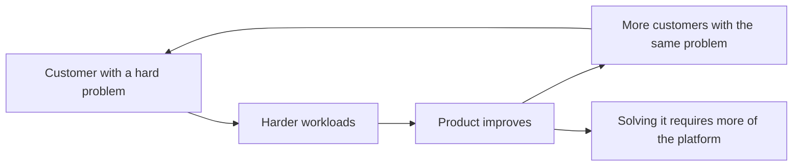

A lot of startups have a good vision and still fail, because they try to build all of it at once.

I've been thinking about this in the context of agent infrastructure. As models get more capable, the environment they work in matters more. An agent needs a real workspace: persistent state, the tools and data it works with, credentials, a browser, a computer. Eventually, companies will also need a way to govern whole fleets of these agents.

That destination is easy to describe, and I think most people in the space would draw roughly the same picture on a whiteboard. What I keep coming back to is how you get there.

## Every request looks like part of the vision

When your vision is broad, every customer request points in roughly the right direction. Someone wants persistent storage? That's on the roadmap anyway. Someone else wants a different networking model? Also fits. A third team wants long-running sessions with custom environments? Of course, that's where this is all going.

So you say yes. Then you say yes again.

Each of these decisions is reasonable on its own, and nobody on the team is doing anything wrong. Six months later you have a product that supports a lot of things and does none of them exceptionally well.

<blockquote class="featured-quote primary">
If you optimize for everyone at the same time, you make a series of reasonable decisions without ever forming a strong opinion about what needs to work first.
</blockquote>

Every use case has a cost. It adds product requirements, infrastructure requirements, support load, and usually a fair amount of hand-holding. That cost is easy to ignore when the request "fits the vision," because fitting the vision feels like permission.

## Who do you want to learn from?

I've learned that the right customers give you a feedback loop you can't get any other way.

When you work with teams that move very fast, their problems force you to move fast too. They don't politely wait for the next release. They push the product until it breaks and tell you exactly where it broke. That shows you what matters to them, and which parts of your big vision need to exist *first*.

Slow customers teach you slowly. Fast customers with real urgency can teach you in weeks what would take a year to figure out internally.

So for an early platform company, the most important strategic question is often simpler than "what should we build?":

**Who do we want to learn from?**

Exposure to many companies and use cases helps, but it also makes it tempting to treat every conversation as another piece of the platform you'll eventually need.

## Hand-holding is product discovery in disguise

This one took me a while to appreciate. The hands-on work that looks like "services" (sitting with a customer, debugging their setup, helping them get a workflow running end to end) is often where the best product learning happens.

You find the missing abstractions this way. You see the same three pieces of glue code written by five different customers. You notice that the thing everyone struggles with isn't the thing you thought was hard. A planning doc won't show you that; you have to be close enough to feel the pain yourself.

It also builds a kind of loyalty that features don't. People forget which features you shipped, but they remember who helped them make it work, and that memory lasts longer than most launch announcements.

The catch is that hand-holding only compounds if it points in one direction. Helping ten customers with ten unrelated problems is a consulting business. Helping ten customers with the same problem is product research.

## Look for urgency, repeatability, and learning

So how do you pick? I'd look for the customer or use case with the strongest combination of three things:

1. Urgency: they need this working now, not next quarter.
2. Repeatability: other teams have the same problem in roughly the same shape.
3. Learning: solving it teaches you something you need for the bigger picture.

Then ask a few blunt questions:

- Where can you make someone dramatically more effective *today*?
- Where does having all the pieces together (in the agent case: browser, computer, state, credentials, tools, environment) make a clear difference compared to assembling them separately?
- Which of these problems naturally pulls you toward the larger thing you want to build?

I'd weigh the last one most, because a wedge that leads nowhere is just a niche.

## One workflow, end to end

Most infrastructure products start as one important piece of someone else's stack. The customer still has to solve everything around it: the setup, the integration, the edge cases, the operations.

That's fine as a starting point. The opportunity is to pick *one* workflow and remove most of that surrounding complexity, so that for that problem, the customer has nothing left to wire together.

Every layer of the eventual vision doesn't have to be equally mature. One path through the product has to feel complete.

## Different agents, different pressure

This matters even more for agents, because workloads that look alike from far away behave very differently up close.

A coding agent, a long-running operational agent, an internal company agent, and a personal agent all "need a computer," but they put pressure on different parts of the system:

- The coding agent cares about fast environment setup, filesystems, and tight iteration loops.
- The operational agent cares about running for hours or days without falling over.
- The internal company agent cares about access to company systems, permissions, and audit trails.
- The personal agent cares about identity, credentials, and trust.

Even basic concepts like persistence, storage, networking, or environment setup take different shapes depending on which of these you serve. Optimize deeply for one too early and you lose room to maneuver later. Try to serve all of them equally and you serve none of them well.

<blockquote class="featured-quote accent">
Preserve optionality at the platform level. Get opinionated at the use-case level.
</blockquote>

That's the balance I'd aim for. Keep the core primitives flexible enough that you don't paint yourself into a corner, and pick one use case where you have strong, specific opinions about how it should work.

## The market-size trap

The obvious way to pick a wedge is to choose the biggest market. I don't think that's the right filter, at least not at the start.

Two candidates in the agent space:

- AI-native companies that move very fast. They need infrastructure immediately and will push it hard, so you learn quickly.
- Companies building internal agents. They need persistent environments, access to internal systems, and much stronger controls, so you learn what "enterprise-ready" means in practice.

There are others. The more useful question is which one creates the strongest feedback loop *and* pulls the product toward the long-term vision. A huge market that teaches you slowly can be worse than a smaller one that teaches you fast.

## The wedge earns you the rest

If the vision is good, your platform can probably support many kinds of customers eventually. So I'd ask a different question:

**Which customer problem earns you the right to build the rest of the platform?**

You know you've found it when customers keep saying some version of: *"Without you, this was really hard. With you, it became straightforward."*

When customers say that, it starts a loop:

The customer brings you harder workloads. Those workloads force the product to get better. The better product attracts more customers with the same problem. And if you chose the wedge well, solving that problem keeps pulling you into more of the platform you wanted to build anyway.

The vision stays the same. What changes is that you have a clear order for building it.

## The questions I'd make explicit

If you're building a platform with a big vision, write down the answers to these:

1. Who are we building for first?
2. What do they need us to do end to end?
3. What can we deliberately ignore for now?
4. If this wedge works, what does it naturally pull us into next?

The third one is the hardest. Saying no to a request that fits the vision feels wrong, but every "not yet" buys focus for the thing that has to work exceptionally well first.

If you answer those four honestly, the big vision gets much easier to execute, because you have a sequence to follow and not only a destination to hope for.
